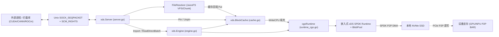

# `pkg/xds` 设计与使用文档

`pkg/xds` 为 JuiceFS 提供**设备无关（Device-Agnostic）的嵌入式 xDS SPDK 本地 NVMe 缓存引擎**与**跨进程显存 P2P 直读服务**，使外部训练/推理进程在不修改或极小修改业务代码的前提下，将 JuiceFS 文件数据通过 NVMe → 加速卡（NVIDIA / Ascend / Iluvatar / AMD）P2P DMA 路径直接读入显存。

---

## 1. 设计目标与硬约束

1. **零修改 `xDS/` 子模块**：仅链接 `xDS/include/xds/{runtime,blob_pool,io,dma_registry,completion}.h` 公开 C API。
2. **嵌入式 Runtime 架构**：独立 `xds_service` 强制按 queue 独占 blob 与已注册 buffer（跨 queue 访问返回 `-EPERM`），因此由 JuiceFS 挂载进程直接嵌入 `xds_runtime`，统一托管 NVMe Slab 缓存池与跨进程导入的设备显存 DMA 映射。
3. **100% 设备无关**：`pkg/xds` 不依赖任何 CUDA / HIP / CANN / COREX SDK，也不包含厂商分支；`DeviceBackend` 与 `PeerExport` 仅作为不透明元数据透传给 xDS 内核驱动。
4. **零循环依赖 & 旁路解耦**：不引入 `pkg/chunk`、`pkg/vfs`、`pkg/meta` 或 `pkg/fuse`；仅作为显存直通旁路（Sidecar）引擎挂载在 `vfs.XDSResolver` 下，**不接管**普通 POSIX/FUSE 读写的 `chunk.CacheManager`。
5. **条件编译隔离**：默认构建（无 `-tags xds` 或非 Linux 平台）自动回退到 `runtime_stub.go`，不给标准 JuiceFS 二进制增加任何 CGo / SPDK 依赖。

---

## 2. 模块划分与文件一览

```text
pkg/xds/
├── proto.h          # 外部 C/C++ 客户端跨进程 Unix SOCK_SEQPACKET 协议头文件（含 C11 _Static_assert）
├── config.go        # Config / DeviceBackend(JSON) / EndpointInfo / 错误定义与参数规范化
├── runtime.go       # Runtime 抽象接口与与 CGo 解耦的数据类型（支持纯内存 fakeRuntime 单测）
├── runtime_cgo.go   # Linux + -tags xds 的 CGo 实现：直调 xDS C API + 进程内无锁全局 CQ & eventfd netpoller
├── runtime_stub.go  # 默认/非 Linux 编译期占位 Stub（返回 ErrUnsupported）
├── metrics.go       # Prometheus 指标定义与注册
├── engine.go        # Engine：托管 Runtime 生命周期、Blob 租约、BlockCache 与 P2P DMA 入口
├── cache.go         # BlockCache：64 分片 pin-safe NVMe Slab 块缓存（1:1 映射 SPDK Cluster）
├── server.go        # Server：Unix SOCK_SEQPACKET 服务端、文件/显存注册与并发流水线直读调度
└── xds_test.go      # 协议布局、缓存淘汰/CRC/窗口读、服务端直读/流水线/排空/崩溃清理单测
```

### 核心设计决策

#### 2.1 NVMe Slab 缓存与 FastMap 100% 命中（`cache.go`）
- **1:1 槽位对齐**：`Config.BlockSize`（默认 4 MiB）直接作为 SPDK `cluster_size_bytes`，`BlobSize` 为 `BlockSize` 的整数倍（默认 64 MiB = 16 slots/blob）。每个缓存块完整落在单个 SPDK cluster 内，保证 `enable_fast_map = true` 下读取直达物理 LBA，无需查 Blobstore 元数据。
- **Pin-Safe 淘汰与延迟回收**：`BlockCache` 内部维护 64 分片 `simplelru` 与纯 Go `slotPins []atomic.Uint32`。在途 DMA 通过 `Pin(key)` 在分片锁内原子递增引用计数；淘汰（`evictOne` 轮询分片单次加锁）会跳过已 pin 槽位；`Remove` 卸载被 pin 块时将槽位放入 `retiredSlots`，待 pin 归零后由 `allocSlot` 自动回收，绝不覆盖在途 DMA 内存。
- **纯旁路直通定位**：数据面仅保留 `BlockCache.Put`（对象存储缺块写入 NVMe）与 `Pin` + `ReadDirectBatch`（NVMe → 显存 P2P DMA），彻底移除无用的 CPU 读路径与无效 CRC 计算开销。

#### 2.2 统一 `SOCK_SEQPACKET` 流水线 + Go 原生并发模型（`server.go` / `runtime_cgo.go`）
- **控制面与数据面合一**：所有消息复用同一条 Unix `SOCK_SEQPACKET` 连接（天然保序、保留消息边界、支持 `SCM_RIGHTS` 传 fd 与 `SO_PEERCRED` 鉴权）。客户端可通过 `req_id` 并发流水线发送最多 `MaxInflight`（默认 64）条 `MSG_READ_DIRECT` 请求。
- **标量/散射读合一**：`JFS_XDS_MSG_READ_DIRECT` 头部 56 字节后紧跟 `slice_count`（1~64）个 24 字节 `slice`，1-slice 标量读仅 80 字节；回包 `JFS_XDS_MSG_READ_DIRECT_REPLY` 头部 40 字节后紧跟 `hole_count`（0~32）个 24 字节稀疏空洞，0 空洞回包仅 40 字节且零堆分配。
- **全异步无锁 CQ + 零 OS 线程阻塞**：`runtime_cgo.go` 直接 `#include "xds/*.h"` 调用同步控制 API，并在内部维护 1 个进程私有的 4096 槽无锁 MPSC 完成队列（CQ）与 1 个接入 Go `epoll` netpoller 的 `eventfd`。提交 I/O 立即返回，业务 goroutine 挂在 Go `chan error`（零 OS 线程占用）；SPDK reactor 回调仅执行 wait-free 入队与 `armed` 合并唤醒（高负载零 syscall），单分发 goroutine 每次 CGo 批量 drain 最多 64 条完成事件；常规批量（`<= 32` desc、`<= 64` iov）热路径零堆分配。
- **单 goroutine 所有权**：每个连接的 `files` / `bufs` 映射仅由 `handleConn` 单读循环访问（无需会话表锁）；`writeMu` 串行化回包写入；任何写错误立即 `sess.cancel()` 唤醒阻塞读/背压路径。

---

## 3. 核心调用链路

### 3.1 系统组件关系



### 3.2 显存直读完整时序（握手 → 绑定 → 注册 → 流水线直读 → 注销/断连）

```mermaid
sequenceDiagram
    participant C as 外部客户端
    participant S as xds.Server (handleConn)
    participant W as Read Goroutine
    participant R as FileResolver (JuiceFS)
    participant B as BlockCache
    participant E as Engine / runtime_cgo / SPDK

    C->>S: MSG_HELLO
    S-->>C: MSG_HELLO_REPLY (io_unit_size, block_size, max_inflight, peer_bdfs, device_backend)

    C->>S: MSG_BIND_FILE + SCM_RIGHTS(file_fd)
    Note over S: fcntl(F_GETFL) 校验可读; statx(AT_STATX_DONT_SYNC) 校验同挂载点普通文件（不触发 FUSE upcall）
    S-->>C: MSG_BIND_FILE_REPLY (file_token, inode, file_size)

    C->>S: MSG_REGISTER_BUF + SCM_RIGHTS(p2p_fd, peer_exports)
    S->>E: ImportBuffer -> xds_direct_import_buffer + io_ptr
    S-->>C: MSG_REGISTER_BUF_REPLY (buf_token)

    C->>S: MSG_READ_DIRECT (req_id, file_token, off, len, slices[1..64])
    Note over S: 同步校验 slices 越界与求和; 获取 inflightSem; b.inflight.Add(1) 与 ioWG.Add(1)
    S->>W: go execReadDirect(...)
    W->>R: ResolveRead(sess.ctx, ino, off, len)
    R-->>W: []BlockExtent, fileSize (未命中块已 Put 进 BlockCache)
    W->>B: Pin(ext.Key) + 双指针切分 IOV / 合并稀疏空洞
    W->>E: ReadDirectBatch(descs) -> xds_submit_read_batch + <-slotCh (无锁 CQ 异步回调)
    E-->>W: NVMe→显存 P2P DMA 完成
    W->>B: defer Unpin(pinnedSlots)
    W-->>C: MSG_READ_DIRECT_REPLY (req_id, bytes_read, holes[0..32])
    Note over W: defer b.inflight.Done(), <-inflightSem, ioWG.Done()

    C->>S: MSG_UNREGISTER_BUF (buf_token)
    Note over S: delete(bufs) -> b.inflight.Wait() 等待在途 DMA 排空
    S->>E: UnregisterBuffer -> xds_direct_unregister_buffer
    S-->>C: MSG_STATUS (0)
```

### 3.3 旁路缺块回填路径（`BlockCache.Put`）
1. 显存直读未命中 `BlockCache` 时，由 `vfs.XDSResolver` 通过 `chunk.BlockLoader.LoadBlock`（先只读检查本地 POSIX 缓存/writeback staging，未命中则经 `store.group` 单飞拉取并带重试）获取明文堆外 `*Page`，**不回写 POSIX 磁盘缓存**；
2. `BlockCache.Put(key, data)` → 分配/淘汰未 pin 槽位 → `Runtime.WriteCPU`（按 `IOUnitSize` 向上对齐并零填充尾块，不持有分片锁）→ 写入分片 LRU（支持可选 `CacheExpire` 过期）。

### 3.4 异常断连与优雅关闭链路
- **客户端崩溃**：`conn.ReadMsgUnix` 返回 EOF → `teardown()` 调用 `sess.cancel()` 取消在途 `ResolveRead` → `sess.ioWG.Wait()` 等待所有在途 SPDK DMA 完成并释放 `BlockCache` pin → 逐个调用 `Engine.UnregisterBuffer` 释放内核 P2P 映射。
- **服务端关闭**：必须先调用 `Server.Close()`（取消 `s.ctx` → `context.AfterFunc` 立即关闭空闲连接 → `s.wg.Wait()` 排空全部会话与在途 DMA → 删除 socket 文件），再调用 `Engine.Close()`（释放所有 leased blobs → `xds_blob_pool_teardown` + `xds_runtime_stop`）。

---

## 4. 使用方法

### 4.1 编译与挂载

- **标准编译（无需 xDS / SPDK）**：`make juicefs` 自动使用 `runtime_stub.go`，不给标准二进制增加任何 CGo / SPDK 依赖。
- **开启 xDS 支持（Linux）**：构建好 xDS 运行时动态库 `dist/xds/libjfs_xds_runtime.so` 后执行：
  ```sh
  make juicefs.xds
  ./juicefs.xds mount --xds-config /etc/juicefs/xds.json sqlite3://meta.db /mnt/jfs
  ```
  CGo 编译期引用 `xDS/include` 与 `xDS/kernels/include`，链接路径为 `dist/xds`（见 `runtime_cgo.go`）。
  挂载启动后，普通 POSIX/FUSE 读写与 `--cache-dir` / `--os-cache` / `--writeback` **完全保持原生路径不变**；`xds.Engine` 与 `xds.Server` 仅作为显存 P2P 直通旁路运行（未命中时通过 `chunk.BlockLoader` 单飞拉取并直接写入 `xds.BlockCache`，不污染 POSIX 磁盘缓存），并在挂载根目录暴露 `0444` 虚拟文件 `.xds`（同时在 `.config` 中追加 `xds` 字段）供外部进程发现。

- **外部 C/C++ 客户端库（`sdk/xds`）**：
  ```sh
  make -C sdk/xds all   # 生成 libjfs_xds.so / libjfs_xds.a
  ```
  设备无关封装 `jfs_xds_discover_socket` → `jfs_xds_connect` → `jfs_xds_bind_file` → `jfs_xds_register_buffer` → `jfs_xds_read` / `jfs_xds_readv`。

### 4.2 配置文件示例

`LoadConfig` 的 JSON 字段与 xDS 原生配置保持一致，可直接复用或扩展：

```json
{
  "bdev_name": "Nvme0n1",
  "json_config_file": "/etc/xds/spdk_bdev.json",
  "reactor_mask": "0x3",
  "main_core": 0,
  "rpc_addr": "/var/tmp/spdk-jfs.sock",
  "xds_peer_bdfs": ["0000:3b:00.0"],
  "xds_device_backend": "nvidia",
  "xds_metadata_page_count": 4096,
  "block_size": 4194304,
  "xds_blob_size_bytes": 67108864,
  "xds_blob_count": 64,
  "xds_enable_blob_fast_map": true,
  "verify_checksum": false,
  "socket_path": "/var/run/juicefs-xds.sock",
  "allow_other": false,
  "max_inflight": 64
}
```

关键参数说明：

| 字段 | 默认值 | 说明 |
| --- | --- | --- |
| `xds_device_backend` | `"nvidia"` | 支持 `"nvidia"` / `"ascend"` / `"iluvatar"` / `"amd"`，自动与 `DeviceBackend` 枚举 JSON 互转 |
| `block_size` | `4 MiB` | 须与 JuiceFS `chunk.Config.BlockSize` 一致且 4 KiB 对齐，同时作为 SPDK cluster 大小 |
| `xds_blob_size_bytes` | `16 * block_size` | 须为 `block_size` 的正整数倍 |
| `xds_blob_count` | **必填 (>0)** | 预租用的 SPDK blob 数量，总缓存槽位数 = `blob_count * (blob_size / block_size)` |
| `xds_enable_blob_fast_map` | `true`（`LoadConfig`） | 开启 SPDK FastMap 直达 LBA |
| `socket_mode` | `0600` / `0666` | 未指定时按 `allow_other` 自动设置 |
| `max_inflight` | `64` | 单客户端允许并发在途的最大 `MSG_READ_DIRECT` 数量 |

### 4.3 在 JuiceFS 挂载进程中接入示例

```go
package main

import (
	"context"
	"log"

	"github.com/juicedata/juicefs/pkg/xds"
	"github.com/prometheus/client_golang/prometheus"
)

// jfsResolver 由上层 pkg/vfs + pkg/chunk 实现，向 pkg/xds 提供块映射与缓存填充。
type jfsResolver struct {
	mountDev uint64
	cache    *xds.BlockCache
}

func (r *jfsResolver) MountDev() uint64 { return r.mountDev }

func (r *jfsResolver) ResolveRead(ctx context.Context, ino, offset, length uint64) ([]xds.BlockExtent, uint64, error) {
	// 1. Flush ino 在 [offset, offset+length) 区间内的脏写；
	// 2. 查询元数据得到各数据块/空洞切分；
	// 3. 对缓存未命中的块从对象存储拉取并调用 r.cache.Put(key, data) 写入 NVMe；
	// 4. 返回有序 []xds.BlockExtent 及当前 fileSize。
	return nil, 0, nil
}

func startXDS(cfgPath string, reg prometheus.Registerer, mountDev uint64) (*xds.Engine, *xds.Server, error) {
	cfg, err := xds.LoadConfig(cfgPath)
	if err != nil {
		return nil, nil, err
	}
	// rt 传 nil 时自动使用 NewDefaultRuntime()（-tags xds 为真实 SPDK，否则为 stub）。
	eng, err := xds.NewEngine(cfg, nil, reg)
	if err != nil {
		return nil, nil, err
	}

	resolver := &jfsResolver{mountDev: mountDev, cache: eng.Cache()}
	srv, err := xds.NewServer(eng, resolver)
	if err != nil {
		_ = eng.Close()
		return nil, nil, err
	}

	// 将 srv.EndpointInfo() 写入 JuiceFS 虚拟文件 .config，供外部客户端自动发现。
	_ = srv.EndpointInfo()

	go func() {
		if err := srv.Serve(); err != nil {
			log.Printf("xds server stopped: %v", err)
		}
	}()
	return eng, srv, nil
}

// 退出时严格先停 Server 再停 Engine：
//   _ = srv.Close()
//   _ = eng.Close()
```

### 4.4 外部客户端协议约定（`proto.h`）

外部 C/C++ 客户端（如未来的 `LD_PRELOAD` 拦截库或数据加载器）直接 `#include "proto.h"` 并连接 `EndpointInfo.SocketPath`（`AF_UNIX` + `SOCK_SEQPACKET`）：

1. **握手**：发送 `jfs_xds_hello`，收到 `jfs_xds_hello_reply` 获取 `io_unit_size`、`block_size`、`max_inflight`、`device_backend` 及 `peer_bdfs`。
2. **绑定文件**：发送 `jfs_xds_bind_file` 并通过 `SCM_RIGHTS` 附带客户端已打开的可读文件 fd，获得 `file_token`（不再需要时发 `JFS_XDS_MSG_UNBIND_FILE`）。
3. **注册显存**：调用 xDS P2P 设备节点导出目标显存（对应所有 `peer_bdfs`），发送 `jfs_xds_register_buf` + `SCM_RIGHTS(p2p_fd)`，获得 `buf_token`（释放显存前须先发 `JFS_XDS_MSG_UNREGISTER_BUF` 并等待成功返回）。
4. **显存直读**：发送 `jfs_xds_read_direct_req` + 紧随其后的 `slice_count` 个 `jfs_xds_slice`（1 ≤ `slice_count` ≤ 64，所有 `slice.length` 之和必须等于 `req.length`）。
   - **对齐要求**：文件块偏移与长度须满足 `io_unit_size` 对齐（通常为 4096B），否则返回 `-EINVAL`（客户端可回退普通读路径）。
   - **稀疏空洞处理**：若回包 `hole_count > 0`（最多 32 段；超出返回 `-E2BIG`），客户端按紧跟在 `jfs_xds_read_direct_reply` 后的 `jfs_xds_hole` 数组对对应显存区间执行异步清零。

---

## 5. Prometheus 指标

构造 `Engine` 时传入 `prometheus.Registerer` 即可自动注册以下指标（`metrics.go`）：

| 指标名 | 类型 | 说明 |
| --- | --- | --- |
| `xds_cache_hits_total` / `xds_cache_misses_total` | Counter | NVMe 块缓存命中/未命中次数 |
| `xds_cache_evictions_total` | Counter | 缓存槽位淘汰次数 |
| `xds_cache_slots_used` / `xds_cache_bytes_used` | Gauge | 当前已占用的槽位数与有效负载字节数 |
| `xds_direct_read_requests_total` / `xds_direct_read_errors_total` | Counter | 跨进程直读请求总数与失败数 |
| `xds_direct_read_bytes_total` | Counter | 跨进程直读累计字节数 |
| `xds_direct_read_duration_seconds` | Histogram | 跨进程直读端到端耗时分布 |
| `xds_active_sessions` | Gauge | 当前在线外部客户端会话数 |
| `xds_imported_buffers` | Gauge | 当前已导入的跨进程 P2P 设备显存数量 |

---

## 6. 开发与验证

`xds_test.go` 内置纯内存 `fakeRuntime`，无需真实 NVMe 或加速卡即可执行完整并发与协议测试：

```sh
# 1. 运行全套单测与竞态检测
go test -race -v -count=1 ./pkg/xds/...

# 2. 静态检查（默认模式、xds CGo 模式含 -Wall -Wextra、跨平台非 Linux 模式）
go vet ./pkg/xds/...
CGO_CFLAGS="-Wall -Wextra" go vet -tags xds ./pkg/xds/...
GOOS=darwin go vet ./pkg/xds/...

# 3. 校验 proto.h 在 C11 / C++11 下的全部 _Static_assert 布局断言
gcc -fsyntax-only -Wall -Wextra -std=gnu11 -x c pkg/xds/proto.h
g++ -fsyntax-only -Wall -Wextra -std=c++11 -x c++ pkg/xds/proto.h
```
